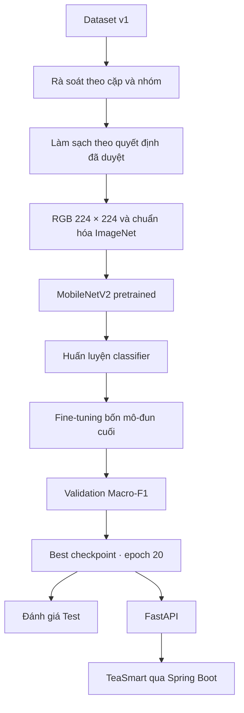
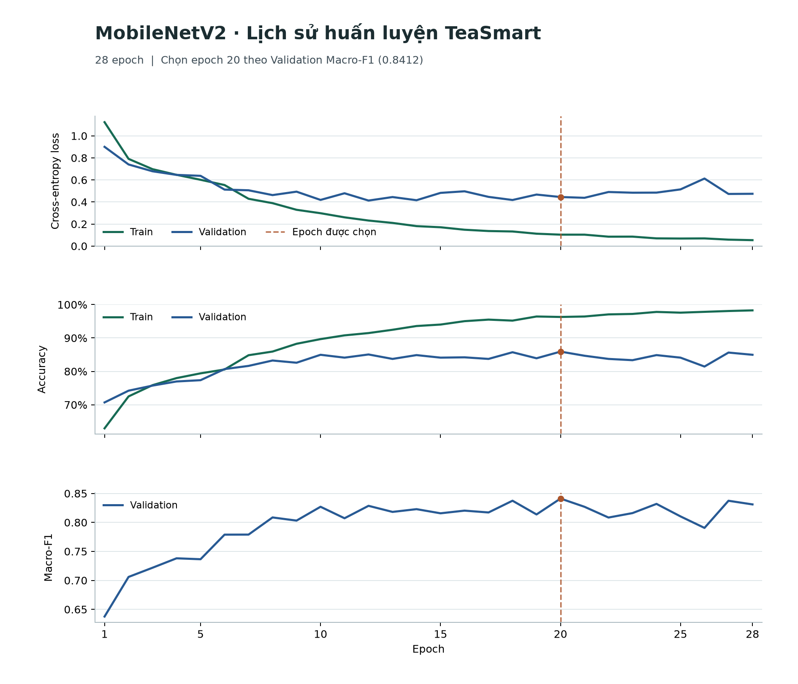
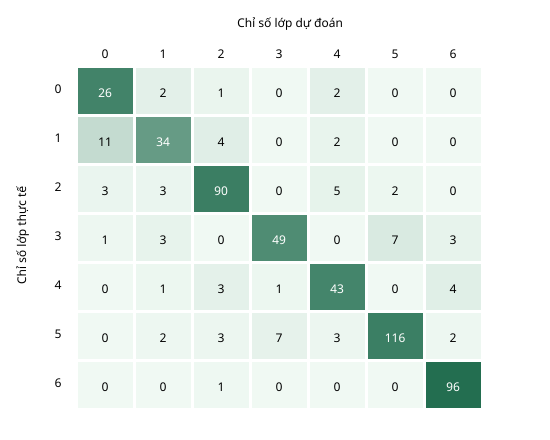

#  TeaSmart AI Leaf · Seven-Class Tea Leaf Condition Classification

Mô hình MobileNetV2 phân loại một ảnh lá chè vào một trong bảy nhóm tình trạng. Trên 530 ảnh Test, checkpoint được chọn bằng Validation dự đoán đúng **454 ảnh (85,66%)**, với **Macro-F1 82,55%**. Kho này chứa mã và hồ sơ thực nghiệm phục vụ đồ án và bài viết *Phân loại bảy nhóm tình trạng lá chè bằng học chuyển giao với mạng MobileNetV2*.

[Website React](https://github.com/BigBoss1208/TeaSmart-FE) · [Spring Boot và FastAPI](https://github.com/BigBoss1208/TeaSmart-Be) · [Manifest checkpoint](MODEL_ARTIFACTS.json)

## Mục lục

- [Dữ liệu và nhãn](#dữ-liệu-và-nhãn)
- [Phương pháp](#phương-pháp)
- [Kết quả thực nghiệm](#kết-quả-thực-nghiệm)
- [Tái lập và tích hợp](#tái-lập-và-tích-hợp)
- [Tác giả và tài liệu tham khảo](#tác-giả-và-tài-liệu-tham-khảo)

## Dữ liệu và nhãn

TeaSmart sử dụng bản xuất Roboflow v1 đã gán nhãn, gồm 5.275 ảnh kích thước 224 × 224. Sau đối chiếu ảnh và cách ly 47 ảnh, còn 3.647 Train, 1.051 Validation và 530 Test. Từng ảnh giữ nguyên tập và nhãn ban đầu. [Nguồn, giấy phép và quyết định làm sạch](docs/dataset.md).

| Chỉ số | Nhãn gốc | Train | Validation | Test |
|---:|---|---:|---:|---:|
| 0 | 1. Tea algal leaf spot | 296 | 91 | 31 |
| 1 | 2. Brown Blight | 335 | 109 | 51 |
| 2 | 3. Gray Blight | 721 | 183 | 103 |
| 3 | 4. Helopeltis | 401 | 130 | 63 |
| 4 | 5. Red spider | 357 | 103 | 52 |
| 5 | 6. Green mirid bug | 890 | 247 | 133 |
| 6 | 7. Healthy leaf | 647 | 188 | 97 |

## Phương pháp

Ảnh được resize toàn khung. Chỉ Train dùng lật ngang, xoay nhẹ và biến đổi độ sáng, tương phản. MobileNetV2 dùng trọng số ImageNet V2 và classifier 7 đầu ra. Trong 5 epoch đầu, backbone đóng băng. Từ epoch 6, mở bốn mô-đun cuối, giữ BatchNorm của backbone ở chế độ đánh giá. AdamW tối ưu cross-entropy với batch 8 và seed 42. Early stopping dừng ở epoch 28 trong tối đa 30 epoch. Epoch 20 đạt Validation Accuracy 85,92% và Macro-F1 0,8412. [Cấu hình thực nghiệm](configs/experiment.json) · [Mã model](model.py) · [Lịch sử từng epoch](results/training_history.csv).

## Kết quả thực nghiệm

| Accuracy | Macro Precision | Macro Recall | Macro-F1 | Weighted-F1 |
|---:|---:|---:|---:|---:|
| 85,66% | 82,23% | 83,51% | 82,55% | 85,66% |

Trong 76 ảnh dự đoán sai, 11 ảnh Brown Blight được xếp vào Tea algal leaf spot. Hai nhóm Helopeltis và Green mirid bug có 7 ảnh bị nhầm theo mỗi chiều. Healthy leaf đúng 96/97 ảnh. Các số liệu đo trên ảnh. Độ đồng thuận giữa các khung video là một đầu ra của dịch vụ triển khai; hiệu quả phân loại video chưa được đánh giá trên bộ Test video. [Kết quả từng lớp](results/class_metrics.csv) · [Ma trận số đếm](results/confusion_matrix.csv) · [Dự đoán đã lưu](results/predictions.csv).

## Tái lập và tích hợp

[Hướng dẫn cài đặt, chuẩn bị dữ liệu, huấn luyện và xác minh checkpoint](docs/reproduction.md). Môi trường huấn luyện dùng Windows, RTX 2050, PyTorch CUDA 12.6. Backend bàn giao dùng PyTorch CPU 2.6.0 và Torchvision CPU 0.21.0. FastAPI kiểm checksum, mapping và preprocessing khi nạp checkpoint rồi nhận ảnh hoặc tối đa tám khung video qua Spring. [Mã dịch vụ Leaf](https://github.com/BigBoss1208/TeaSmart-Be/tree/main/ai-service/leaf_app).

| Vị trí | Nội dung |
|---|---|
| [scripts](scripts) và [data_records](data_records) | Mã phục hồi, kết quả sàng lọc, nhóm và quyết định theo ảnh |
| [dataset.py](dataset.py), [config.py](config.py), [model.py](model.py) | Kiểm manifest, biến đổi ảnh, định nghĩa kiến trúc và tham số |
| [train.py](train.py), [metrics.py](metrics.py) | Huấn luyện hai giai đoạn, chọn checkpoint, tính chỉ số |
| [evaluate.py](evaluate.py), [plot_training.py](plot_training.py) | Xác minh checkpoint, đánh giá độc lập và vẽ đường học |
| [configs](configs), [results](results) | Mapping, cấu hình đã lược đường dẫn máy, CSV/JSON và biểu đồ |

## Tác giả và tài liệu tham khảo

Ngô Quang Mạnh · Đồ án tốt nghiệp TeaSmart · Trường Đại học Công nghệ Thông tin và Truyền thông, Đại học Thái Nguyên.

- rohithdraj810-gmail-com, *My First Project Dataset*, Roboflow Universe, 2026, CC BY 4.0. [Trang dataset](https://universe.roboflow.com/rohithdraj810-gmail-com/my-first-project-yklen).
- Sandler và cộng sự, *MobileNetV2: Inverted Residuals and Linear Bottlenecks*, CVPR 2018. [Bài báo kiến trúc](https://openaccess.thecvf.com/content_cvpr_2018/html/Sandler_MobileNetV2_Inverted_Residuals_CVPR_2018_paper.html).
- [Torchvision MobileNetV2](https://docs.pytorch.org/vision/stable/models/generated/torchvision.models.mobilenet_v2.html).
